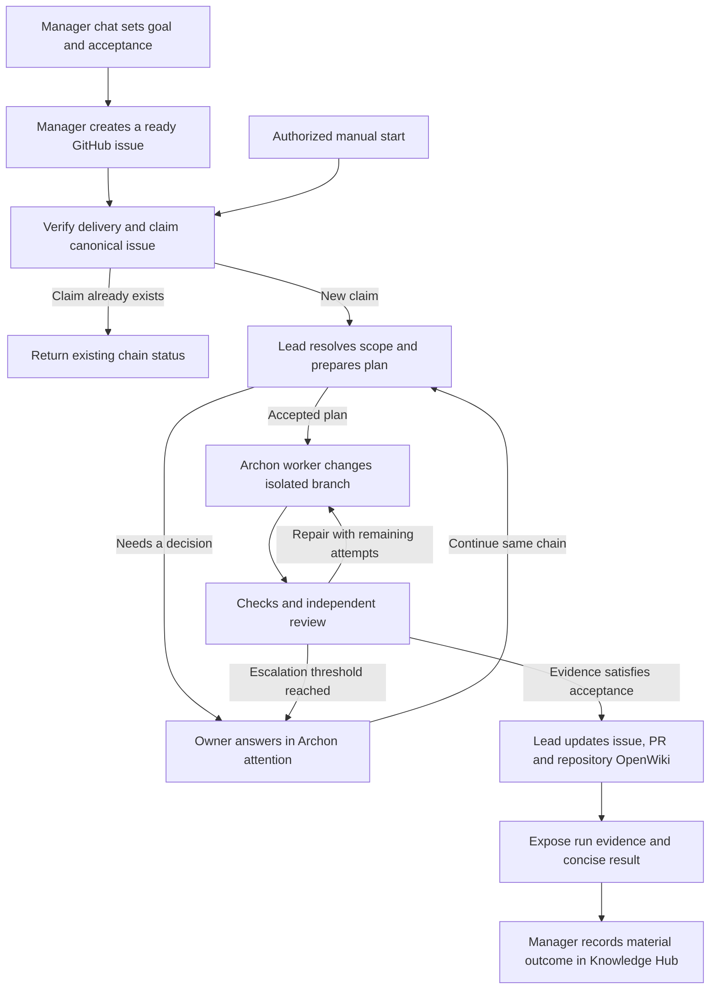

# Agentic development management

**Status:** proposed architecture, not a deployed system. This note captures the agreed operating model and the points still requiring implementation. See the [primary Archon routing stack](record:5d1e098b-24fc-43c6-b2d5-d68237742559) for the independently verified runtime, gateway and tracing baseline.

## Responsibilities and boundaries

| Layer | Owns | Does not own |
| --- | --- | --- |
| Human / Manager | Goals, scope, portfolio priorities, meaningful decisions and concise management reporting | CSS fixes, detailed tests or live engineering context |
| Repository Lead | Issue scope, repo architecture, workflow selection, technical acceptance, iterative validation, evidence and escalation | Portfolio strategy or bypassing approval gates |
| Archon workflow executor | Versioned execution graphs, isolated runs, specialist workers, retries, tool calls, validation artifacts and durable work-item history | Changing the goal silently or declaring product success from a passing run |
| Pi / ExtremeRouter / Phoenix | Model execution, routing and observed traces | Task ownership and business acceptance |

A Manager and Lead are **roles invoked on demand**, not permanently running LLM sessions. Existing Archon state, the repository and events carry continuity. An idle Manager should cost zero model tokens.

## Two entry points; one task chain

- **Manual:** the owner converses with the Manager, who defines or changes the goal and delegates to the appropriate repository Lead. The Manager invocation can end while Archon work continues.
- **Automated:** GitHub issue, label, Kanban or scheduled events invoke the repository Lead through an authenticated, deduplicating trigger. Routine events do not require the Manager model.
- Both modes resolve the **same canonical task identity** (for GitHub, repository plus issue number) and reconcile requests against the same active Lead chain.
- The Manager can inspect, interrupt, reprioritize or request evidence for any chain, but does not create a competing Lead for an already owned task.

## One active chain per task

The intended invariant is **at most one active Lead chain for a canonical task**, regardless of manual or automated entry. That chain may launch multiple sequential or intentionally parallel child workflows under its authority.

Archon's documented item admission already prevents two concurrent runs of the **same workflow** on one item; this alone does **not** prove exclusivity across different workflow types. The missing enforcement is task-wide admission/ownership with atomic claim, idempotent event receipt, chain reuse, exclusive delegation authority and safe crash recovery. Pending owner instructions should be folded into the existing chain at the next safe reconciliation point. A lease/fencing generation is a possible mechanism, subject to implementation design and validation.

Do not treat role/model stickiness (A05) as task-chain ownership: its key is workflow/task/role/attempt and solves a different problem.

## What lives where

- **Knowledge Hub:** the Manager's concise diary — goals, important milestones, blockers, strategic decisions and source links. No per-turn transcripts, routine implementation rounds or exhaustive technical logs.
- **GitHub issue / PR:** Lead-owned delivery contract and current scope; acceptance, review and code evidence. One issue can contribute to a larger management goal; do not create one new issue per iteration.
- **Repository OpenWiki:** Lead-owned detailed design, architecture, acceptance rationale, unresolved findings and decisions, with links to issue, commits and evidence.
- **Archon work item / runs:** canonical task link, chain owner, workflow/run identities, validation results, artifacts, attention and external-event waits. Prefer the existing state model over duplicating live state in Knowledge Hub.
- **Phoenix:** privacy-preserving execution diagnostics and evaluations; it is not durable task memory.

## UI failure example: three poor iterations

1. A new issue asks for a UI improvement. The Lead establishes a target, acceptance criteria and visual references; then invokes `ui_development`.
2. A separate `ui_validation` reviews the running UI in a browser, compares viewports/reference images, checks regressions and records specific findings with screenshots and commit references.
3. After three unsuccessful attempts, the Lead reads the accumulated validation ledger. It should **not** blindly call `ui_development` again; it may choose design review, root-cause investigation, a narrower repair, or escalation.
4. The Manager receives only a concise outcome, for example: "Functional fixes landed; visual hierarchy still fails acceptance; Lead switched to design-first investigation." Detailed failures stay with the Lead.
5. Only evidence satisfying the original (or explicitly revised) goal permits completion. Workflow PASS is not automatically goal PASS.

The persistent validation context must include the original goal/version, outstanding findings, attempted approaches, commit/run and screenshot references, decisions and next action. A compact structured handoff is preferable to replaying long LLM transcripts.

## Interaction contracts (proposed)

**Manager → Lead:** canonical goal ID, repo/task reference, outcome and constraints, priorities, permissions/budget, requested decision or status, and correlation ID.

**Lead → Archon:** exact workflow, canonical item/chain identity, versioned acceptance contract, current context/evidence references, safety and budget constraints.

**Lead → Manager:** concise progress, outcome versus goal, material blocker, recommendation/decision request and evidence links — not raw technical details.

All workflows must keep their configured validation and merge gates; an LLM cannot override a deterministic denial or silently change acceptance criteria.

## Verification before adoption

- Confirm installed local Archon version supports required work-item, dispatch, chat and trigger APIs (upstream documentation is not deployment evidence).
- Demonstrate manual and webhook starts for one issue converge on one active Lead chain, including simultaneous duplicate and out-of-order events.
- Verify separate workflow types cannot claim competing chains; intentional child runs remain possible.
- Prove interrupted, restarted and re-triggered Leads recover the same task and complete without stale-owner writes.
- Show a three-round failed UI task preserves findings and changes strategy; no false completion on green implementation tests.
- Verify Knowledge Hub logs a short manager-facing milestone and that all technical evidence remains reachable via repository and Archon links.
- Measure model cost and enforce limits; manager invocations are demand-driven, and routine triggers use deterministic filtering where feasible.

## Open decisions

Task-wide ownership implementation and recovery policy, the exact Manager-to-Lead dispatch interface, lead escalation thresholds, and whether the conversational Manager is hosted in Archon Web/Telegram or a separate authorized client remain to be proven. Do not present these proposals as deployed functionality.

## Workflow and handoff

[Design and validation tracker #139](https://github.com/tempuku/knowledge-hub-starter/issues/139) tracks the controller, recovery and evaluation work.

Any chat with permission to create GitHub issues can act as Manager. The Manager supplies the outcome, acceptance checks, scope and exclusions, evidence required, and the authorization for dispatch. The ready signal is the `archon:ready` label applied by an authorized actor. GitHub issue `opened` with that label and `labeled` for that exact label are admitted. Edits, comments, worker updates and unrelated labels have no start binding. A project board can display the issue and its state as a view for humans.

A canonical issue key, delivery receipt and durable claim converge manual and webhook starts. The harness records a run ID when Archon accepts the launch. If a launch times out, it reconciles by the exact task marker and leaves uncertain dispatches held for an operator. The pilot freezes the admitted issue snapshot. A changed or closed issue before dispatch cancels that intake. A future revision command should update the owning chain at a safe boundary and record the new version and decision. A direct work start outside the harness remains outside the pilot ownership guarantee.

The Lead retains the issue scope, acceptance checks and technical context in the issue and repository OpenWiki. The worker receives the Lead's versioned plan and changes code in an isolated worktree. An independent review checks the actual commit and evidence. For ordinary in-scope repairs, the Lead may retry within the configured cap. The pilot fixture uses three failed validation attempts. A real workflow sets its own cap and must change approach or ask for a decision when it reaches that cap. The validation ledger retains each finding, attempted fix, revision, run link and the remaining evidence. The Manager returns to any chat, reads the issue and run summary, and appends material outcomes to the existing Knowledge Hub record. An issue summary or status update can link to evidence without providing a start event. Automated result publication and the Manager diary write still require live verification.

## Model routes

| Step | Recommended route | Condition |
| --- | --- | --- |
| Manager conversation and material diary update | A model in the user's current chat | Invoke on demand. The issue or existing record carries the handoff. |
| Signature, authorization, admission, policy, and readiness probe | Deterministic code | These decisions are inspectable and use zero model tokens. |
| Optional issue classification | Pi `opencode-go/archon-triage` | Use only when issue routing cannot be read directly from labels or the template. |
| Lead plan and scope reconciliation | Pi `opencode-go/archon-planner` | Current recorded primary is DeepSeek V4.1 Flash through OpenCode Go. |
| Implementation worker | Pi `opencode-go/archon-coder` | Current recorded primary is DeepSeek V4.1 Flash. Keep the route stable within an attempt. |
| Independent review | Pi `opencode-go/archon-reviewer` | Latest gateway evidence records ReformBoss Kimi K3.1 Pro first. A DeepSeek fallback on a DeepSeek-authored patch cannot satisfy the independent-review gate. |

The current Pi catalog exposes the logical routes above. The latest local gateway evidence reports ReformBoss GPT-6 Luna registered but denied before dispatch by the budget ledger's unknown-pricing check. Enable that route only after pricing, ACL, budget enforcement, and a real Archon/Pi tool round-trip are verified. A Luna subagent used for harness implementation is separate from the model routed by the local gateway.

## Where the owner decides

| Situation | Pause behavior | Decision |
| --- | --- | --- |
| Missing acceptance criteria, conflicting constraints, or new scope | Lead records the gap and keeps the same chain | Approve a precise interpretation, revise the issue, or stop. |
| Three failed implementation/review rounds | Lead preserves the ledger and stops automatic repair | Approve a narrower approach or route to design review. |
| Privileged, privacy-sensitive, costly or irreversible work | Deterministic gate holds the action with the requested scope | Grant bounded authority or decline. Existing repository policy still applies. |
| No eligible independent review route or budget remains | Hold product acceptance and retain the results | Approve a permitted independent reviewer or defer. |
| Ambiguous launch after crash | Keep the issue claimed and inspect Archon run history | Attach the existing run or attest there was no launch before a retry. |
| Release or merge requires approval | Present the checked commit and evidence | Accept or reject that revision under the repo's release rules. |

A duplicate delivery, routine progress update, or approved in-scope repair does not ask the owner a question. Product acceptance follows evidence, while any human decision is recorded against the same issue and scope version.

## Definition of done

- A Manager chat creates one authorized GitHub issue. Applying `archon:ready` causes the GitHub webhook to reach the local harness, without a manual Archon command for that issue.
- A redelivery and a concurrent manual start reuse the same claim. The receipt, canonical issue key, and exactly one Archon run ID can be traced together.
- The read-only pilot run records the checked commit, tracked `AGENTS.md`, OpenWiki index, acceptance criteria, and up to three documented validation entry points. It leaves its isolated checkout clean.
- The Manager can read a short result and run artifact through the existing issue or a stable result view. Publishing the result generates no second start.
- A separate synthetic or authorized implementation task proves Lead → worker → independent reviewer and preserves the target commit and checks. A three-failure fixture stops at human attention with the revision and accumulated findings. The test includes returning an owner decision to the same chain.
- The Lead records technical findings in the target repository's OpenWiki when authorized. The Manager records only the material milestone and authorized evidence links in the existing Knowledge Hub record and sibling log.
- The harness survives restart without starting a competing chain. Router evidence names the actual upstream model per AI role, or marks it unknown. Missing evidence leaves the corresponding step open.

## Local verification boundary

The inspected Archon installation reports 0.13.2 and exposes trigger receipts, detached workflow launch, run lookup and attention via its CLI. Its local workflow help does not advertise the newer native item start option. The prototype uses a SQLite issue claim and the Archon run ID to join those facts. A disposable CLI dispatch persisted a failed launch that could be located by its marker. The execution environment denied both loopback TCP and Unix socket binds, so a live web receipt and a surviving detached workflow could not be established in that session. Synthetic admission, launch reconciliation and validation fixtures are offline evidence. The live issue-to-result path remains an open acceptance check.
